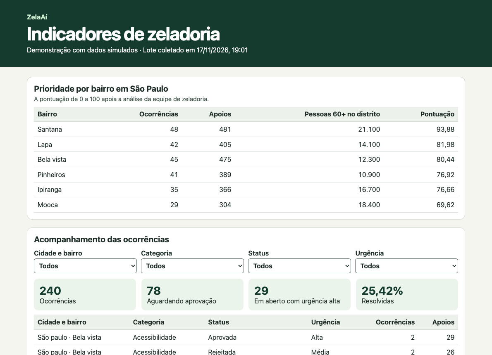

# ZelaAí · Pipeline de Dados

## Ficha Técnica do MVP

| Campo | Descrição |
| --- | --- |
| Produto | ZelaAí, plataforma de zeladoria urbana acessível |
| Integrantes | RM553377 - Enzo Rodrigues RM552632 - Gabriel Mediotti RM553266 - Hugo Santos RM553384 - Maria Júlia RM553521 - Rafael Cristofali |
| Cidadão e território | Moradores de São Paulo, com foco em pessoas idosas e pessoas com deficiência |
| Problema | Falhas no espaço público, como calçadas danificadas e semáforos inoperantes, são difíceis de reportar e acompanhar. |
| Proposta de valor | O cidadão registra e acompanha a ocorrência. O gestor analisa e aprova com apoio da triagem. O RPA protocola no Portal 156. |
| Arquitetura | API Node.js no Azure App Service, PostgreSQL, triagem GenAI, OCR, UiPath e pipeline Apache Airflow. |
| Fontes | Ocorrências do ZelaAí via REST e, quando disponíveis, recortes normalizados de GeoSampa, IBGE e SP156. A demonstração é integralmente simulada. |
| IA | Triagem de categoria e urgência, com regras de contingência e decisão humana. OCR de comprovantes no backend. O ranking do pipeline usa uma fórmula determinística. |
| URLs | [API em produção](https://zelai-api.azurewebsites.net/health) · [Swagger](https://zelai-api.azurewebsites.net/docs) · [Repositório da API](https://github.com/Rodriguessz/zelai-api) |
| Indicadores | Ocorrências e apoios por bairro, taxa de resolução e prioridade distrital. O backend calcula também o tempo médio até o protocolo 156. |
| ODS | ODS 9, infraestrutura resiliente (meta 9.1). ODS 10, inclusão (10.2). ODS 11, mobilidade acessível e espaços públicos inclusivos (11.2 e 11.7). |

## Entregáveis

**Global Solution 2026.2 · Big Data Architecture & Data Integration · 4ESPR**

| Entregável solicitado | Onde encontrar |
| --- | --- |
| 1. Pipeline orquestrado e instruções de execução | [DAG do Airflow](dags/zelai_ocorrencias.py), [código do ETL](zelai_data/) e [guia de execução](docs/execucao.md). |
| 2. Diagrama de arquitetura e dicionário de dados | [PDF único](output/pdf/zelai-big-data.pdf), páginas 1–4. |
| 3. Evidências do pipeline em execução | [Grafo, logs, dados carregados e captura do painel](docs/evidencias/README.md). O resumo está na página 5 do PDF. |

**Avaliação** · Pipeline funcional, 8 pontos. Arquitetura e documentação, 6 pontos.

## 1. Pipeline e instruções de execução

A DAG `zelai_ocorrencias` executa a ingestão paginada, o tratamento, a carga no SQLite, as verificações de qualidade e a publicação. O [guia de execução](docs/execucao.md) explica como reproduzir o lote de demonstração e configurar a integração com a API e o PostgreSQL do ZelaAí.

## 2. Arquitetura e dicionário de dados

O [PDF único da entrega](output/pdf/zelai-big-data.pdf) reúne a documentação exigida.

| Páginas | Conteúdo |
| --- | --- |
| 1 e 2 | Arquitetura em C4. A vista de contexto mostra usuários e sistemas externos. A vista de contêineres mostra o limite do pipeline e os contratos de integração. |
| 3 e 4 | Dicionário de `fato_ocorrencia`, `prioridade_por_bairro`, `mart_ocorrencias` e `controle_lote`, com tipos, chaves e descrições. |
| 5 | Evidências da demonstração no Airflow e da integração local com o MVP. |

## 3. Evidências de execução

| Requisito | Evidência verificável |
| --- | --- |
| DAG no Airflow | [Grafo exportado da execução](docs/evidencias/airflow-dag.svg) com as cinco tarefas concluídas. |
| Logs do pipeline | [Execução de demonstração](docs/evidencias/airflow-demo.txt) com 240 registros em três páginas e [teste de integração local](docs/evidencias/airflow-api.txt) com 106 registros em duas páginas. |
| Dados carregados | [Contagens consultadas no SQLite](docs/evidencias/carga-demo.json) e [ranking retornado por GET /indicadores](docs/evidencias/indicadores-local.json) após a gravação no PostgreSQL local. |

Os dois lotes foram executados com dados fictícios. A integração com PostgreSQL foi validada no backend ZelaAí em ambiente local. Consulte o [índice de evidências](docs/evidencias/README.md) para o contexto de cada execução.

### Prévia do painel

Painel gerado pelo lote de demonstração com 240 ocorrências fictícias em seis bairros.

