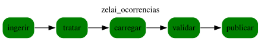

# Evidências de execução · ZelaAí

Execuções manuais em 17/11/2026 com Apache Airflow 3.4.0 e Python 3.12.

## Demonstração

O grafo foi exportado pelo Airflow no formato [DOT](airflow-dag.dot) e renderizado a partir desse arquivo. Os cinco nós verdes correspondem a tarefas bem-sucedidas.

- [Trecho do log Airflow](airflow-demo.txt) · 240 registros em 3 páginas, sem rejeições.
- [Contagens consultadas no SQLite](carga-demo.json) · fato, mart, ranking e controle reconciliados.
- [Captura do painel](painel-demo.png) · ao selecionar o status Resolvida, o painel recalculou o total para 61. Ao limpar o filtro, voltou para 240.

## Integração local com o MVP

A DAG executou contra o backend ZelaAí no commit [c9a6dd5](https://github.com/Rodriguessz/zelai-api/commit/c9a6dd50ca4dc649bcf8e5a384ecff02f114d965) e um PostgreSQL local com a migração 002. A fonte foi a API de verdade em loopback, com 106 ocorrências fictícias e três CSV de contexto preparados para o teste.

- [Trecho do log Airflow](airflow-api.txt) · autenticação, paginação e publicação de três bairros.
- [Resposta sanitizada de GET /indicadores](indicadores-local.json) · o backend devolveu o ranking gravado pela DAG, inclusive um bairro sem dado populacional.

As evidências usam dados fictícios. O modo de produção usa credenciais da equipe e os recortes públicos oficiais podem ser configurados seguindo o README.
